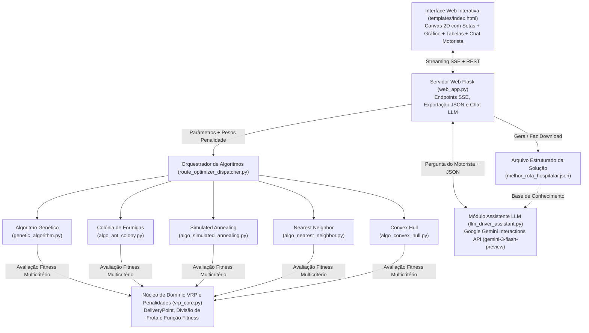

# Visão Geral e Documentação Técnica do Projeto (Etapas 1, 2 e 3)
**Tech Challenge — Fase 2 | Projeto 2: Otimização de Rotas para Distribuição de Medicamentos e Insumos**

---

## 1. Objetivo e Funcionamento Geral do Sistema

O sistema resolve o problema do **"Caixeiro Viajante Médico" ampliado para Múltiplos Veículos (VRP — *Vehicle Routing Problem*)** para um hospital universitário.

Em vez de apenas encontrar o caminho mais curto entre pontos (como no TSP clássico), o sistema precisa distribuir medicamentos e insumos partindo de um **Hospital Universitário Central (Centro de Distribuição / Depósito)** para diversas unidades de saúde (UTIs, Pronto-Socorros, UPAs, UBS) e pacientes domiciliares (*Home Care*), respeitando **restrições reais de logística hospitalar**:

1. **Múltiplos Veículos Heterogêneos**: A frota possui $N$ veículos configuráveis, onde **cada veículo possui sua própria capacidade máxima de carga (em kg) e sua própria autonomia máxima de distância (em pixels/km)**.
2. **Prioridades Médicas de Entrega**:
   - **Nível 3 — Crítico (UTI / Emergência)**: Hemoderivados, kits de intubação, quimioterápicos, cilindros de $O_2$. Devem ser entregues nas primeiras paradas dos veículos.
   - **Nível 2 — Urgente (Refrigerados / UPA)**: Insulina refrigerada, antibióticos pediátricos, anticoagulantes.
   - **Nível 1 — Regular (Insumos Básicos)**: Soro fisiológico, luvas, gazes, vacinas de rotina, fraldas hospitalares.
3. **Retorno Obrigatório ao Depósito**: Todo veículo parte do Hospital Central (`#0`), atende sua sequência de unidades e retorna ao Hospital Central (`#0`).

---

## 2. Organização das Pastas e Arquitetura do Código

O projeto em `Fase 2\7 - Tech Challenge` foi organizado em duas pastas independentes para separar a versão inicial desktop da versão web completa:

```
Fase 2/7 - Tech Challenge/
│
├── Local - Simples/                    # Versão inicial (Desktop em Pygame)
│   ├── tsp.py                          # Loop principal em Pygame
│   ├── genetic_algorithm.py            # Algoritmo Genético e modelagem VRP inicial
│   ├── draw_functions.py               # Funções de desenho Pygame e geração de gráficos
│   ├── benchmark_att48.py              # Dataset clássico de referência da aula
│   └── melhor_rota_hospitalar.json     # Arquivo JSON exportado na execução local
│
└── Web - Completo/                     # Versão Web Completa (Etapas 1, 2 e 3 + Exportação JSON + Docker)
    ├── web_app.py                      # Servidor Web (Flask) com Streaming SSE e exportação/download JSON
    ├── templates/
    │   └── index.html                  # Interface Web Interativa (Canvas 2D com setas, Gráfico, Tabelas e Controles)
    │
    ├── vrp_core.py                     # NÚCLEO VRP: Pontos, Divisão de Frota, Função Fitness e Penalidades (usado por todos)
    ├── route_optimizer_dispatcher.py   # Orquestrador Principal: monta os pesos de penalidade e invoca o algoritmo escolhido
    │
    ├── genetic_algorithm.py            # Algoritmo 1: Algoritmo Genético (GA - apenas operadores evolucionários)
    ├── algo_ant_colony.py              # Algoritmo 2: Ant Colony Optimization (Colônia de Formigas - ACO)
    ├── algo_simulated_annealing.py     # Algoritmo 3: Simulated Annealing (Têmpera Simulada + 2-opt)
    ├── algo_nearest_neighbor.py        # Algoritmo 4: Nearest Neighbor (Vizinho Mais Próximo + 2-opt)
    ├── algo_convex_hull.py             # Algoritmo 5: Convex Hull (Envoltória Convexa + Inserção)
    │
    ├── llm_driver_assistant.py         # Etapa 4: Copiloto do Motorista integrado ao Google Gemini com .env
    ├── melhor_rota_hospitalar.json     # Solução gerada pelo botão "Gerar JSON da Solução" na Web
    ├── test_vrp_system.py              # Suíte de Testes Automatizados (unittest) de ponta a ponta
    ├── requirements.txt                # Lista de dependências Python (Flask, Gunicorn, Google-GenAI, Dotenv, etc.)
    │
    ├── Dockerfile                      # Receita de conteinerização Docker com Python 3.11-slim e Gunicorn
    ├── docker-compose.yml              # Orquestrador Docker com mapeamento 127.0.0.1:5000, .env e restart automático
    ├── .dockerignore                   # Exclusão de caches e ambientes virtuais da imagem Docker
    ├── .env.example                    # Template versionado com modelo da variável GEMINI_API_KEY
    ├── .env                            # Arquivo local com a chave secreta da API (ignorado pelo Git)
    ├── OVERVIEW_PROJETO.md             # Este documento técnico em formato Markdown
    └── OVERVIEW_PROJETO.txt            # Este documento técnico em formato Texto Puro
```

### Fluxo de Execução na Arquitetura Web (`Web - Completo`)
1. O usuário configura na tela (`templates/index.html`) os pontos de entrega, a quantidade de veículos (com carga e autonomia individual de cada um), os **pesos de penalidade da função Fitness**, escolhe o algoritmo desejado e clica em **"Executar Otimização"**.
2. O navegador abre uma conexão de *Server-Sent Events (SSE)* com o endpoint `/api/optimize/stream` no arquivo `web_app.py`.
3. O `web_app.py` repassa os dados e os pesos de penalidade para a função `dispatch_optimization()` dentro de `route_optimizer_dispatcher.py`.
4. O `route_optimizer_dispatcher.py` aciona o arquivo específico do algoritmo escolhido (`genetic_algorithm.py`, `algo_ant_colony.py`, `algo_simulated_annealing.py`, `algo_nearest_neighbor.py` ou `algo_convex_hull.py`).
5. **Todos os 5 algoritmos** importam e utilizam `evaluate_solution_details()` do módulo compartilhado `vrp_core.py` (aplicando os mesmos pesos de penalidade configurados na tela) e devolvem o resultado (`yield`) em tempo real para o navegador desenhar as rotas com setas direcionais e atualizar o gráfico de convergência.
6. Ao encontrar uma solução, o botão **"📄 Gerar JSON da Solução"** fica habilitado. Quando clicado, envia um `POST` para `/api/solution/generate-json`, que grava o arquivo estruturado `melhor_rota_hospitalar.json` no servidor e exibe o botão **"⬇️ Baixar JSON da Solução"** (`/api/solution/download-json`) para download direto pelo navegador.

---

## 3. Como uma Rota é Dividida entre os Veículos e Avaliada (Função Fitness em `vrp_core.py`)

Toda a regra de negócio hospitalar, divisão de frota e cálculo de penalidades está centralizada no módulo neutro **`vrp_core.py`** (de modo que `genetic_algorithm.py` contenha apenas o Algoritmo Genético e todos os 5 algoritmos compartilhem exatamente o mesmo avaliador de penalidades):

### 3.1. Decodificação de Rota para Múltiplos Veículos (`split_route_into_vehicles`)
- Qualquer algoritmo trabalha com uma **sequência permutada de entregas** (ex.: `[#1, #12, #6, #13, #4, #3, #11, ...]`).
- A função `split_route_into_vehicles()` lê a lista de especificações individuais dos veículos (`vehicles_specs`) na ordem `Veículo 1, Veículo 2, ..., Veículo N`.
- O `Veículo 1` sai do Hospital Central (`#0`) e começa a acumular entregas da sequência:
  - Antes de visitar o próximo ponto, o sistema verifica:
    1. **Teste de Capacidade**: `carga_atual + peso_do_ponto > capacidade_maxima_deste_veiculo`?
    2. **Teste de Autonomia**: `distancia_atual + trecho_ate_ponto + retorno_ao_hospital > autonomia_maxima_deste_veiculo`?
  - Se qualquer um dos dois limites for ultrapassado **e** houver um próximo veículo disponível na frota, o veículo atual encerra sua viagem voltando ao Hospital Central e o **próximo veículo assume** a partir dali com seus próprios limites de carga e autonomia!
  - Se todos os veículos disponíveis na frota já tiverem sido usados, o último veículo é forçado a levar os pontos restantes, gerando um **excesso de carga ou autonomia** que será penalizado na Função Fitness.

### 3.2. Cálculo da Função Fitness e Penalidades Configuráveis na Web (`evaluate_solution_details`)
O problema é de **minimização**: quanto **menor** o valor do Fitness, **melhor** é a solução.

A fórmula exata do Fitness Total é:

$$\text{Fitness Total} = \text{Distância Total} + \text{Penalidade de Prioridade} + \text{Penalidade de Capacidade} + \text{Penalidade de Autonomia}$$

Todos os **3 pesos de penalidade** podem ser alterados diretamente na seção **"3. Penalidades da Função Fitness"** da barra lateral na interface Web:

1. **Distância Total (`total_distance`)**:
   - Soma das distâncias euclidianas percorridas por todos os veículos (incluindo a saída do Hospital Central e o retorno ao Hospital Central).

2. **Penalidade de Prioridade Médica (`priority_penalty`) — Configurável via `Peso Prioridade Médica` (Padrão: `0.35`)**:
   - Mede o quão tarde uma entrega **Crítica (nível 3)** ou **Urgente (nível 2)** foi atendida dentro da rota do veículo.
   - Para cada veículo, conforme ele avança na sua sub-rota, acumulamos a distância viajada (`cumulative_dist`) e o número da parada (`stop_index = 1º, 2º, 3º...`):
     - Se a parada for **Crítica (`priority == 3`)**:
       $$\text{Penalidade} += (\text{cumulative\_dist} \times 1.2 + (\text{stop\_index} - 1) \times 45.0) \times \text{priority\_penalty\_weight}$$
     - Se a parada for **Urgente (`priority == 2`)**:
       $$\text{Penalidade} += (\text{cumulative\_dist} \times 0.4 + (\text{stop\_index} - 1) \times 15.0) \times \text{priority\_penalty\_weight}$$
     - Se a parada for **Regular (`priority == 1`)**: não gera penalidade de atraso (pode ficar para o final da rota do veículo sem custo extra).
   - **Efeito prático ao alterar na Web**: Se você aumentar esse peso (ex.: de `0.35` para `1.5`), os algoritmos forçarão os veículos a visitar todas as entregas Críticas (UTI/Emergência) imediatamente nas primeiras paradas, mesmo que precisem cruzar a cidade para isso. Se colocar `0.0`, o algoritmo ignorará a urgência médica e focará apenas na menor distância física.

3. **Penalidade por Excesso de Capacidade de Carga (`capacity_penalty`) — Configurável via `Multa Excesso Carga (por kg)` (Padrão: `40.0`)**:
   - Se um veículo carregar mais peso do que o seu limite individual (`capacity_exceeded > 0`):
     $$\text{Penalidade de Capacidade} = \text{quilos\_excedentes} \times \text{capacity\_penalty\_weight}$$
   - **Efeito prático ao alterar na Web**: Define o rigor contra sobrecarga de peso nos veículos.

4. **Penalidade por Excesso de Autonomia (`autonomy_penalty`) — Configurável via `Multa Excesso Autonomia (por px)` (Padrão: `15.0`)**:
   - Se a distância total da viagem de um veículo ultrapassar sua autonomia máxima individual (`autonomy_exceeded > 0`):
     $$\text{Penalidade de Autonomia} = \text{pixels\_excedentes} \times \text{autonomy\_penalty\_weight}$$
   - **Efeito prático ao alterar na Web**: Define o rigor contra rotas que excedam o alcance máximo de combustível/bateria do veículo.

---

## 4. Como Funciona Cada um dos 5 Algoritmos Implementados

### 4.1. Algoritmo Genético (`genetic_algorithm.py`)
Inspirado na evolução biológica e seleção natural:
- **População Inicial**: Cria `population_size` rotas diferentes. Se a opção *Híbrida* estiver ativa, inclui sementes geradas pelo Vizinho Mais Próximo para acelerar o início, mantendo o resto 100% aleatório para garantir diversidade genética.
- **Avaliação e Elitismo**: Calcula o Fitness de cada rota da população, ordena da melhor para a pior e preserva intactos os 2 melhores indivíduos para a próxima geração (*Elitismo*).
- **Seleção dos Pais**: Combina **Seleção por Torneio** (70% das vezes sorteia 4 indivíduos e escolhe o melhor) com **Seleção por Roleta** (30% das vezes sorteia com probabilidade proporcional a $1/\text{Fitness}$).
- **Cruzamento (`order_crossover` — OX)**: Copia uma fatia contínua da rota do Pai 1 e preenche o restante na ordem em que os pontos aparecem no Pai 2, garantindo que nenhum hospital seja repetido ou esquecido.
- **Mutação Híbrida (`mutate`)**: Com probabilidade `mutation_probability`, aplica uma de três operações:
  1. *Inversão 2-opt (55%)*: Inverte um trecho da rota para descruzar linhas no mapa;
  2. *Swap Geral (30%)*: Troca duas unidades de posição;
  3. *Avanço de Prioridade Crítica (15%)*: Escolhe uma entrega Crítica (vermelha) e a puxa para mais perto do início da rota.

### 4.2. Ant Colony Optimization — Colônia de Formigas (`algo_ant_colony.py`)
Inspirado no comportamento de formigas reais que depositam feromônio nos melhores caminhos:
- **Matriz de Feromônio ($\tau_{ij}$)**: Guarda a "memória coletiva" de quão bom é ir do ponto $i$ para o ponto $j$.
- **Visibilidade Heurística ($\eta_{ij}$)**: Calculada como $\frac{\text{prioridade}_j^{0.85}}{\text{distância}_{ij}}$. Assim, pontos próximos e com alta prioridade médica são naturalmente mais atraentes.
- **Construção por Formigas**: Em cada iteração, `n_ants` formigas constroem rotas escolhendo o próximo ponto com probabilidade proporcional a $\tau_{ij}^\alpha \cdot \eta_{ij}^\beta$.
- **Evaporação e Reforço**: Ao fim de cada geração, parte do feromônio evapora (`evaporation_rate`) e as melhores formigas depositam novo feromônio nas arestas que usaram.

### 4.3. Simulated Annealing — Têmpera Simulada (`algo_simulated_annealing.py`)
Inspirado no processo físico de recozimento de metais:
- Começa com uma **Temperatura Inicial alta ($T_0$)** e uma rota inicial.
- A cada passo, gera soluções vizinhas aplicando mutações *2-opt* e *Swap*.
- Se a nova rota for melhor ($\Delta < 0$), ela é aceita imediatamente. Se for pior ($\Delta > 0$), ela ainda pode ser aceita com probabilidade de Boltzmann $P = e^{-\Delta / T}$. Isso permite "subir morros" no começo para escapar de armadilhas (ótimos locais).
- A temperatura cai gradualmente a cada geração ($T_{k+1} = \alpha \cdot T_k$), tornando o algoritmo cada vez mais rigoroso até convergir.

### 4.4. Nearest Neighbor — Vizinho Mais Próximo Multi-Start + 2-opt (`algo_nearest_neighbor.py`)
Heurística construtiva gulosa combinada com evolução local ao longo das gerações:
- Parte do Hospital Central e escolhe sempre a entrega viável mais próxima ponderada pela prioridade médica: $\text{custo} = \frac{\text{distância}}{\text{prioridade}^{\text{peso}}}$, respeitando a carga e autonomia do veículo atual antes de passar para o próximo veículo.
- Ao longo das `n_generations` gerações, aplica **Multi-Start (GRASP)** — adicionando uma taxa de variação/exploração nas escolhas gulosas — e refina a melhor solução com busca local **2-opt** para eliminar cruzamentos.

### 4.5. Convex Hull — Envoltória Convexa + Inserção (`algo_convex_hull.py`)
Heurística geométrica clássica para problemas de roteamento:
- Primeiro calcula o **Fecho Convexo (Convex Hull)** usando o algoritmo *Monotone Chain*, formando um anel externo com os pontos mais distantes (garantindo uma base sem cruzamentos).
- Em seguida, insere os pontos internos restantes um a um na posição da rota que causa o **menor aumento no Fitness VRP** (*Cheapest Insertion*).
- Ao longo das `n_generations` gerações, testa variações na ordem de inserção dos pontos internos (`perturbation_rate`) e aplica ajustes locais de prioridade e *2-opt*.

---

## 5. Resumo de Todos os Parâmetros e Ações na Interface Web (`http://localhost:5000`)

| Seção na Barra Lateral | Parâmetro / Botão na Tela | O que faz na prática |
| :--- | :--- | :--- |
| **1. Cenário e Coordenadas** | Origem dos Pontos / Quantidade | Alterna entre as 14 unidades hospitalares padrão ou sorteia entre 4 e 35 entregas aleatórias. |
| **1. Cenário e Coordenadas** | Botão *Editar / Adicionar Coordenadas* (ou clique no Mapa) | Permite alterar o Nome, Coordenada X, Coordenada Y, Peso (kg) e Prioridade (1, 2 ou 3) de cada ponto, ou criar novos pontos clicando no mapa. |
| **2. Frota de Veículos** | Quantidade de Veículos (1 a 8) | Define quantos veículos saem do Hospital Central. |
| **2. Frota de Veículos** | Carga Máx (kg) e Autonomia (px) de `V1..VN` | Define o limite máximo de peso e a distância máxima de viagem **individualmente para cada veículo**. |
| **3. Penalidades Fitness** | Peso Prioridade Médica (`0.35`) | Controla o peso da multa quando entregas Críticas (UTI) ou Urgentes não são atendidas logo nas primeiras paradas. |
| **3. Penalidades Fitness** | Multa Excesso Carga por kg (`40`) | Controla a multa somada ao Fitness para cada 1 kg que ultrapasse a capacidade máxima do veículo. |
| **3. Penalidades Fitness** | Multa Excesso Autonomia por px (`15`) | Controla a multa somada ao Fitness para cada 1 px que ultrapasse a autonomia máxima do veículo. |
| **4. Algoritmo Genético** | Tamanho da População, Nº de Gerações, Taxa de Mutação, Inicialização | Controla quantos indivíduos evoluem por geração, por quantas gerações, a chance de mutação (2-opt/Swap) e o uso de semente heurística. |
| **4. Ant Colony (ACO)** | Nº de Formigas, Iterações, Alpha ($\alpha$), Beta ($\beta$), Evaporação | Controla o tamanho da colônia, a influência do feromônio ($\alpha$) vs. distância/prioridade ($\beta$) e a velocidade de evaporação. |
| **4. Simulated Annealing** | Nº de Gerações/Passos, Temperatura Inicial ($T_0$), Taxa de Resfriamento ($\alpha$) | Controla a liberdade inicial de aceitar soluções piores para escapar de mínimos locais e a velocidade de resfriamento. |
| **4. Nearest Neighbor** | Nº de Gerações, Peso da Prioridade, Taxa de Variação, Busca 2-opt | Controla quantas gerações Multi-Start rodar, o peso dado a itens críticos na escolha gulosa e o descruzamento 2-opt. |
| **4. Convex Hull** | Nº de Gerações, Taxa de Perturbação na Inserção, Ajuste Local | Controla quantas gerações de inserção geométrica testar, a variação na ordem dos pontos internos e o refinamento local. |
| **5. Execução e Exportação** | Botão *📄 Gerar JSON da Solução* | Salva a solução encontrada no arquivo `melhor_rota_hospitalar.json` com resumo de métricas, pesos de penalidade e paradas detalhadas por veículo. |
| **5. Execução e Exportação** | Botão *⬇️ Baixar JSON da Solução* | Aparece assim que o JSON é gerado e faz o download imediato do arquivo `melhor_rota_hospitalar.json` para o computador do usuário. |
| **Recursos de Usabilidade (UX)** | Ícones `?` em todos os parâmetros | Tooltips flutuantes elegantes com explicações concisas e práticas sobre cada hiperparâmetro dos algoritmos e do VRP. |
| **Recursos de Usabilidade (UX)** | Card Penalidades com Popover (Hover) | O card exibe a *Penalidade Total* (soma das 3 multas) e, ao passar o mouse, abre um popover detalhado com a decomposição exata de cada uma (Prioridade Médica, Excesso de Carga e Excesso de Autonomia). |
| **Recursos de Usabilidade (UX)** | Gráfico com Eixo X Graduado | O eixo horizontal *Passo / Geração* exibe números graduados dinâmicos (ex: 0, 40, 80, 120, 160) e linhas de grade, alinhados com o eixo Y de Fitness. |
| **Etapa 4: Copiloto Gemini** | Seletor de Motorista, Relatórios e Chat Interativo | Permite que motoristas perguntem sobre seu próximo destino/carga e que gestores gerem relatórios diários/semanais de eficiência e sugestões de melhoria no processo com base no JSON da rota. |

---

## 6. Diagrama de Arquitetura da Solução Completa



---

## 7. Comparativo de Desempenho entre as Abordagens de Roteamento

No cenário hospitalar padrão (**1 Hospital Central + 14 unidades de entrega**, carga total de **215 kg** distribuída em **3 veículos com limite de 85 kg e 950 px de autonomia**), todos os 5 métodos foram avaliados sob a mesma Função Fitness em `vrp_core.py`:

| Algoritmo / Heurística | Tipo de Abordagem | Fitness Médio Típico (Menor = Melhor) | Velocidade por Geração | Características e Comportamento Prático |
| :--- | :--- | :---: | :---: | :--- |
| **Algoritmo Genético (`genetic_algorithm.py`)** | Evolucionário Populacional (OX + 2-opt/Swap) | **~1.960 a 2.040** | Rápida | Excelente equilíbrio entre exploração global e priorização de entregas Críticas (UTI) nas primeiras paradas. |
| **Ant Colony Optimization (`algo_ant_colony.py`)** | Inteligência de Enxame (Feromônio $\tau$ + Visibilidade $\eta$) | **~1.980 a 2.080** | Moderada | Aprende rapidamente boas conexões entre unidades próximas e críticas graças à matriz de visibilidade médica. |
| **Simulated Annealing (`algo_simulated_annealing.py`)** | Meta-heurística de Trajetória Única (Metropolis) | **~1.990 a 2.110** | Muito Rápida | Escapa facilmente de ótimos locais nas primeiras gerações (alta temperatura) e estabiliza bem no resfriamento final. |
| **Nearest Neighbor + 2-opt (`algo_nearest_neighbor.py`)** | Construtiva Gulosa Multi-Start + Busca Local | **~1.970 a 2.060** | Instantânea | Encontra uma rota viável excelente já na 1ª geração e refina cruzamentos com 2-opt ao longo das gerações. |
| **Convex Hull + Inserção (`algo_convex_hull.py`)** | Construtiva Geométrica (Fecho Convexo) + Busca Local | **~2.010 a 2.130** | Rápida | Produz rotas visualmente limpas (sem laços geométricos) partindo do anel externo de unidades hospitalares. |

---

## 8. Etapa 4: Integração com Google Gemini (`llm_driver_assistant.py`)

O módulo `llm_driver_assistant.py` conecta o sistema de otimização à nuvem do **Google Gemini** usando o SDK oficial `google-genai` e a **Interactions API** (`client.interactions.create`):

1. **Base de Conhecimento Estruturada (`melhor_rota_hospitalar.json`)**:
   - Sempre que um motorista ou gestor envia uma solicitação no painel **"Central do Motorista & Copiloto de Rota"**, o backend injeta o JSON oficial da solução dentro do `system_instruction` da chamada ao Gemini.
2. **Instruções para Motoristas, Relatórios de Eficiência e Sugestões de Melhoria**:
   - **Para Motoristas**: Briefing completo do veículo, consulta de próximo destino, peso a descarregar e alertas de manuseio para itens Críticos (UTI/Hemoderivados/O2) e Urgentes (Insulina refrigerada).
   - **Para Gestão Logística**: Botões dedicados para gerar **Relatórios Diários/Semanais de Eficiência** (analisando taxa de ocupação de carga em kg, consumo de autonomia em px e economia de recursos) e **Sugestões de Melhoria no Processo** com base nos padrões da rota.
3. **Memória de Conversa Multi-Turno (`previous_interaction_id`)**:
   - A Interactions API armazena o contexto da conversa e retorna um `interaction.id`. No turno seguinte, o sistema envia `previous_interaction_id`, permitindo perguntas sequenciais naturais como:
     - *Turno 1*: "Qual é o meu primeiro destino saindo do Hospital Central?"
     - *Turno 2*: "Já concluí essa entrega! Qual é a minha próxima parada e quantos quilos vou descarregar lá?"

### 8.1. Interface Responsiva e Navegação Mobile em Abas (Ergonomia para o Motorista)

Para garantir que o **motorista da ambulância ou van de entregas hospitalares** possa utilizar o Copiloto Gemini confortavelmente a partir de seu **smartphone ou tablet no veículo**, a interface web (`templates/index.html`) foi refatorada com um sistema de **Abas Móveis Responsivas (Mobile Tabs)**:

1. **Separação em Abas Especializadas em Telas ≤ 960px**:
   - `⚙️ Config`: Painel com origem dos pontos, limites individuais da frota (carga/autonomia), penalidades da função fitness e seleção dos algoritmos.
   - `🗺️ Mapa`: Painel focado com cards de métricas em tempo real, simulação 2D com setas direcionais, gráfico de convergência e botão de ação rápida (`▶ Executar Otimização`).
   - `📋 Rotas`: Listagem estruturada das rotas atribuídas a cada veículo e tabela de paradas hospitalares com suporte a rolagem suave por toque (`-webkit-overflow-scrolling: touch`).
   - `🤖 Copiloto`: Central de atendimento do motorista conectada ao Gemini, com chips de perguntas rápidas em rolagem horizontal (evitando poluição vertical) e campo de texto com envio imediato.
2. **Proteção contra Toques Acidentais no Canvas de Rotas**:
   - Em smartphones, arrastar o dedo pela tela para navegar disparava cliques indesejados no Canvas, criando pontos aleatórios. Foi implementado o alternador `[📍 Modo Toque: Desativado / Ativado]`, garantindo que o scroll do dedo seja livre e seguro.
3. **Card de Penalidades Adaptado para Telas de Toque**:
   - Em dispositivos móveis (onde não existe o evento `:hover`), tocar no card de penalidades abre a discriminação detalhada (Prioridade Médica, Excesso de Carga e Excesso de Autonomia) como um *bottom-sheet* flutuante.
4. **Preservação Total do Modo Desktop**:
   - Em telas widescreen (> 960px), a barra de abas oculta-se automaticamente e o layout exibe simultaneamente a Sidebar fixa e o grid amplo, mantendo 100% da experiência desktop original.

---

## 9. Testes Automatizados (`test_vrp_system.py`)

Para validar todas as funcionalidades exigidas no Tech Challenge, o arquivo `test_vrp_system.py` implementa testes automatizados com `unittest` cobrindo:
1. Criação do cenário hospitalar e divisão de rotas em múltiplos veículos (`split_route_into_vehicles`);
2. Aplicação correta das penalidades de prioridade médica, capacidade de carga e autonomia (`evaluate_solution_details`);
3. Convergência e retorno válido de todos os **5 algoritmos de otimização** através do `route_optimizer_dispatcher.py`;
4. Funcionamento dos endpoints da API Web (`/api/algorithms`, `/api/optimize/stream`, `/api/solution/generate-json`, `/api/solution/download-json`) e construção do prompt da LLM;
5. **Responsividade Mobile e Template Web (`test_mobile_ui_template_and_responsiveness`)**: Validação da metatag de viewport, elementos da barra de abas móveis, alternador de proteção de toque e regras de media queries CSS.

Para executar os testes automatizados no terminal:
```bash
python -m unittest test_vrp_system.py -v
```

---

## 10. Conteinerização com Docker e Deploy em Produção na VPS (HostGator + CloudPanel + Portainer)

A aplicação foi estruturada seguindo as melhores práticas da indústria (12-Factor App) para deploy profissional em nuvem, garantindo isolamento total, reprodutibilidade e alta disponibilidade.

### 10.1. Conteinerização com Docker (`Dockerfile` e `docker-compose.yml`)
- **Imagem Base**: `python:3.11-slim` com flags `PYTHONDONTWRITEBYTECODE=1` e `PYTHONUNBUFFERED=1` para evitar arquivos temporários e manter logs transmitidos em tempo real.
- **Servidor WSGI de Produção**: A aplicação é executada via **Gunicorn** (`gunicorn --workers 2 --bind 0.0.0.0:5000 --timeout 120 web_app:app`), oferecendo suporte a concorrência e conexões persistentes para o streaming SSE.
- **Healthcheck Nativo**: Monitoramento de integridade via módulo `urllib.request` do Python padrão (`http://localhost:5000/`), sem necessidade de instalar pacotes extras na imagem.
- **Isolamento de Rede Local**: O container expõe a porta `127.0.0.1:5000:5000`, garantindo que conexões externas só entrem pelo Nginx com SSL/HTTPS.
- **Persistência de Dados**: O arquivo estruturado `melhor_rota_hospitalar.json` é mapeado via volume, garantindo que as soluções geradas persistam mesmo após reinicializações.
- **Reinicialização Automática (`restart: unless-stopped`)**: Integrada com o daemon do Docker habilitado no systemd da VPS (`systemctl is-enabled docker -> enabled`). Se o servidor reiniciar por manutenção ou o processo falhar, o container retorna ao ar em menos de 2 segundos.

### 10.2. Arquitetura de Hospedagem em Produção na VPS
A hospedagem foi implementada em uma **VPS Linux (HostGator)** combinando o painel de controle **CloudPanel** com o Docker:

```
[ Usuário na Internet ]
         │ (HTTPS / Porta 443 com Certificado SSL Let's Encrypt)
         ▼
[ Nginx (CloudPanel) ] ── (Host: app.143.95.175.167.nip.io)
         │ (Proxy Reverso / HTTP Local)
         ▼
[ Container Docker: vrp_hospital_web (Porta 127.0.0.1:5000) ]
         │
         ├── Gunicorn (2 Workers)
         ├── Flask (web_app.py)
         └── Google Gemini API (Chave injetada via .env)
```

- **Resolução de Domínio sem Custos Adicionais (`nip.io`)**: Utilização do serviço wildcard DNS `nip.io`, permitindo acessar o sistema em `app.143.95.175.167.nip.io` com suporte nativo à emissão e renovação automática de certificados SSL gratuitos da Let's Encrypt.
- **Segurança de Acesso SSH**: Acesso administrativo à VPS configurado em porta de alta segurança (`22022`) com suporte a autenticação por par de chaves criptográficas `Ed25519`, mitigando tentativas de invasão por força bruta.
- **Segurança de Variáveis de Ambiente**: Chaves de API e segredos mantidos estritamente em arquivo `.env` protegido na VPS e ignorados no repositório Git via `.gitignore`, eliminando riscos de vazamento ou bloqueios por GitHub Push Protection.

### 10.3. Sincronização Otimizada com Git Sparse-Checkout
Para evitar o download desnecessário de todas as aulas e fases anteriores do curso na VPS, o repositório na nuvem foi configurado com **Git Sparse-Checkout**:
```bash
git clone --filter=blob:none --no-checkout https://github.com/AndrCapela/FIAP---IA-para-devs.git /home/app-hospital
cd /home/app-hospital
git sparse-checkout set "Fase 2/7 - Tech Challenge/Web - Completo"
git checkout main
```
Isso mantém o código sincronizado com 1 único repositório Git sem duplicar trabalho e sem ocupar armazenamento com outros materiais.

### 10.4. Gerenciamento e Observabilidade com Portainer CE
Para facilitar o monitoramento operacional da aplicação, foi implantado o **Portainer Community Edition (CE)** conteinerizado na mesma VPS:
- **Acesso Seguro**: `https://portainer.143.95.175.167.nip.io` com SSL dedicado via CloudPanel.
- **Autenticação Segura**: Ativação com `setup_token` gerado nos logs do servidor.
- **Recursos em Produção**:
  1. *Dashboard Visual de Recursos*: Acompanhamento contínuo do consumo de CPU e memória RAM da VPS.
  2. *Live Logs*: Inspeção em tempo real das chamadas à IA do Gemini e requisições SSE dos algoritmos.
  3. *Gestão de Ciclo de Vida*: Ações de Restart, Stop e Deploy de containers com apenas 1 clique.


